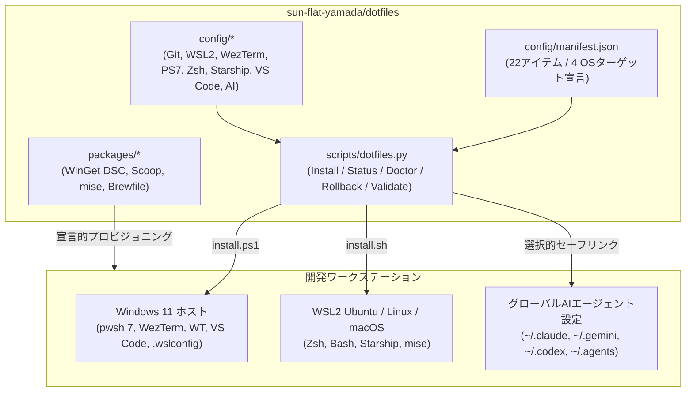

# dotfiles

**Windows 11・WSL2 (Ubuntu)・Linux/macOS を横断し、ターミナル・シェル・エディタ・宣言的パッケージ管理・マルチAIコーディングエージェントのグローバル設定を単一のトランザクショナル基盤で統合管理する 2026 年世代 `dotfiles` リポジトリ。**

[](https://github.com/sun-flat-yamada/dotfiles/actions/workflows/ci.yml)
[](https://github.com/sun-flat-yamada/dotfiles/actions/workflows/secret-scan.yml)
[](config/manifest.json)
[-5332a0?style=flat)](config/vscode/settings.json)
[](LICENSE)
[](https://buymeacoffee.com/sun.flat.yamada)

[English Version (README.md)](README.md) | [🏛️ アーキテクチャ概要](docs/architecture/overview.md) | [📖 実践利用ガイド](docs/guides/getting-started.md) | [🔒 セキュリティポリシー](SECURITY.md) | [📋 ADR 記録集](docs/adr/)

---

## 🌟 主な特徴（2026年ベストプラクティス）

- **宣言的マニフェストによる一元管理 ([`config/manifest.json`](config/manifest.json))**: 全24個の設定アセットを `windows` / `wsl` / `linux` / `macos` の4環境とプロファイル（`full`, `core`, `git`, `wsl`, `terminal`, `shell`, `starship`, `editor`, `ai`, `packages`）にマッピング。
- **外部依存ゼロのトランザクショナル展開エンジン ([`scripts/dotfiles.py`](scripts/dotfiles.py))**: Python 3.10+ 標準ライブラリのみで動作し、[`install.ps1`](install.ps1) / [`install.sh`](install.sh) から呼び出し可能。`--dry-run`（事前プレビュー）、ドリフト検知（`LINKED`, `IDENTICAL`, `DRIFTED`, `MISSING`）、操作ジャーナル方式の自動バックアップ（`~/.dotfiles-backup/<timestamp>/restore-manifest.json`）、Windows リダイレクト `Documents` フォルダの自動解決、シンボリックリンク自動フォールバック、および1コマンドの `rollback` を完備。
- **マルチAIコーディングエージェント・グローバル設定同期 ([`config/ai/`](config/ai/))**: **Claude Code**（`CLAUDE.md`, `settings.json`, `ccstatusline`）、**Google Antigravity / Gemini CLI**（`GEMINI.md`, `settings.json`, `policies/permission-policy.toml`）、**OpenAI Codex CLI**（`config.toml`）、およびエージェント共通規約（`~/.agents/AGENTS.md`）を統合管理。認証トークンや会話履歴（`history.jsonl`）は厳格に除外。
- **統一カラースキーム `Dark 2026`**: **VS Code**、**WezTerm**（WebGPU 120fps描画）、**Windows Terminal**、**Starship** のすべてを `#171c2a`（ディープ背景）・`#a94dc1`（パープル枠）・`#ffd866`（ゴールドアクセント）・`#00B3BD`（シアン）のカラースキームで統一。
- **50ms未満の高速シェル起動 ＆ シークレット履歴フィルタ**: PowerShell 7 と Zsh の双方で重い CLI 初期化（`zoxide`, `mise`）を遅延ロード（Lazy Load）し、APIキーやトークン文字列（`ghp_*`, `gho_*`, `sk-ant-*`, `AIza*` 等）を含むコマンドが履歴ファイルに保存されるのを自動ブロック。
- **宣言的パッケージ＆ランタイム構築 ([`packages/`](packages/))**: **WinGet Configuration DSC**（`configuration.winget`）、**Scoop**（`scoopfile.json`）、**`mise`**（`config.toml`）、**Homebrew**（`Brewfile`）による再現性の高い環境構築。

---

## 🏛️ システムアーキテクチャ



---

## 🚀 クイックスタート

### Windows 11 (PowerShell 7)

```powershell
# 1. リポジトリのクローン（~/dotfiles または任意のワークスペースディレクトリ）
git clone https://github.com/sun-flat-yamada/dotfiles.git "$HOME\dotfiles"
cd "$HOME\dotfiles"

# 2. ファイルを変更せずに適用プレビューを確認 (Dry-Run)
.\install.ps1 -DryRun

# 3. 現在のホームディレクトリとの差分ステータスを確認
.\install.ps1 -Status

# 4. フルプロファイルの適用（既存の差分ファイルは自動バックアップされます）
.\install.ps1 -Profile full

# 5. 環境ヘルスチェック（導入済みツールの診断）
.\install.ps1 -Doctor
```

### WSL2 (Ubuntu) / Linux / macOS

```bash
# 1. リポジトリのクローン
git clone https://github.com/sun-flat-yamada/dotfiles.git ~/dotfiles
cd ~/dotfiles

# 2. 事前プレビュー (Dry-Run) とステータス確認
./install.sh --dry-run
./install.sh --status

# 3. 設定の適用
./install.sh --profile full

# 4. 環境診断
./install.sh --doctor
```

---

## 📦 管理対象コンフィギュレーション一覧

| ID | プロファイル | ソースパス | 対象OS | 主な設計ポイント |
| :--- | :--- | :--- | :--- | :--- |
| `git.config` | `git` | [`config/git/.gitconfig`](config/git/.gitconfig) | Win / WSL / Linux / macOS | `zdiff3`, `histogram`, `rerere`, `fsmonitor`, `updateRefs`, `~/.gitconfig.local` 分離 |
| `git.ignore_global` | `git` | [`config/git/.gitignore_global`](config/git/.gitignore_global) | Win / WSL / Linux / macOS | OS生成ファイル、エディタ一時ファイル、`.env.local`、AI認証/履歴ファイルの全リポジトリ除外 |
| `git.attributes_global` | `git` | [`config/git/.gitattributes_global`](config/git/.gitattributes_global) | Win / WSL / Linux / macOS | Windows (`.ps1` CRLF) と POSIX (`.sh` LF) の改行コード正規化 |
| `wsl.host_config` | `wsl` | [`config/wsl/.wslconfig`](config/wsl/.wslconfig) | Windows | `networkingMode=mirrored`, `dnsTunneling=true`, `autoMemoryReclaim=dropcache`, `sparseVhd=true` |
| `wezterm.config` | `terminal` | [`config/wezterm/wezterm.lua`](config/wezterm/wezterm.lua) | Win / Linux / macOS | WebGPU 120fps描画、`Dark 2026` 配色、Nerd Font フォールバック、カスタムタブ装飾 |
| `wezterm.keybinds` | `terminal` | [`config/wezterm/keybinds.lua`](config/wezterm/keybinds.lua) | Win / Linux / macOS | `Ctrl+q` リーダーキーによるペイン分割・移動・QuickSelect |
| `windows_terminal.fragment` | `terminal` | [`config/windows-terminal/settings.fragment.json`](config/windows-terminal/settings.fragment.json) | Windows | `Dark 2026` カラースキーム＆PowerShell 7 プロファイルフラグメント |
| `powershell.profile_default` | `shell` | [`config/powershell/Microsoft.PowerShell_profile.ps1`](config/powershell/Microsoft.PowerShell_profile.ps1) | Win / Linux / macOS | 50ms未満の遅延ロード（`zoxide`, `mise`）、PSReadLine `ListView`、機密コマンド履歴除外 |
| `powershell.profile_vscode` | `shell` | [`config/powershell/Microsoft.PowerShell_profile.ps1`](config/powershell/Microsoft.PowerShell_profile.ps1) | Windows | VS Code 統合ターミナル用 PowerShell プロファイル同期 |
| `shell.zshrc` | `shell` | [`config/shell/.zshrc`](config/shell/.zshrc) | WSL / Linux / macOS | XDG準拠、24時間キャッシュ `compinit`、WSLクリップボード/ブラウザ連携、機密履歴除外 |
| `shell.bashrc` | `shell` | [`config/shell/.bashrc`](config/shell/.bashrc) | WSL / Linux / macOS | `.aliases` 共有、Starship / `mise` / `zoxide` 統合 Bash 設定 |
| `shell.aliases` | `shell` | [`config/shell/.aliases`](config/shell/.aliases) | WSL / Linux / macOS | `eza` / `bat` モダンCLI優先エイリアス（標準コマンドへの安全なフォールバック付） |
| `starship.config` | `starship` | [`config/starship/starship.toml`](config/starship/starship.toml) | Win / WSL / Linux / macOS | `Dark 2026` パレット統一クロスシェルプロンプト（Git差分行数・各言語ランタイム表示） |
| `vscode.settings` | `editor` | [`config/vscode/settings.json`](config/vscode/settings.json) | Win / Linux / macOS | `Dark 2026` ワークベンチ配色、`HackGen Console NF`、日本語単語区切り、Copilotフック連携 |
| `vscode.keybindings` | `editor` | [`config/vscode/keybindings.json`](config/vscode/keybindings.json) | Win / Linux / macOS | AIチャット入力欄での `Shift+Enter` 送信（`Enter` 単体での誤送信防止） |
| `ai.agents_global` | `ai` | [`config/ai/agents/AGENTS.md`](config/ai/agents/AGENTS.md) | Win / WSL / Linux / macOS | 全AIエージェント共通のグローバル規約（`~/.agents/AGENTS.md`） |
| `ai.claude_md` | `ai` | [`config/ai/claude/CLAUDE.md`](config/ai/claude/CLAUDE.md) | Win / WSL / Linux / macOS | Claude Code グローバル日本語対話原則・コミット規約 |
| `ai.claude_settings` | `ai` | [`config/ai/claude/settings.json`](config/ai/claude/settings.json) | Win / WSL / Linux / macOS | Claude Code グローバル設定（`language: "japanese"`, `ccstatusline` 連携） |
| `ai.ccstatusline` | `ai` | [`config/ai/ccstatusline/settings.json`](config/ai/ccstatusline/settings.json) | Win / WSL / Linux / macOS | Claude Code ステータスライン設定（モデル、コンテキスト長、リセットタイマー、使用量、Git状態） |
| `ai.gemini_md` | `ai` | [`config/ai/gemini/GEMINI.md`](config/ai/gemini/GEMINI.md) | Win / WSL / Linux / macOS | Google Antigravity / Gemini CLI グローバル設定 |
| `ai.gemini_settings` | `ai` | [`config/ai/gemini/settings.json`](config/ai/gemini/settings.json) | Win / WSL / Linux / macOS | Gemini CLI グローバル設定（`disableYoloMode: true`, `sandbox: true`） |
| `ai.gemini_policy` | `ai` | [`.gemini/policies/permission-policy.toml`](.gemini/policies/permission-policy.toml) | Win / WSL / Linux / macOS | Gemini CLI グローバル権限ガードレール（`~/.gemini/policies/`） |
| `ai.codex_config` | `ai` | [`config/ai/codex/config.toml`](config/ai/codex/config.toml) | Win / WSL / Linux / macOS | OpenAI Codex CLI グローバル設定（サンドボックス＆機密環境変数除外） |
| `packages.mise` | `packages` | [`packages/mise/config.toml`](packages/mise/config.toml) | Win / WSL / Linux / macOS | 言語ランタイム＆CLIツール定義（`node`, `python`, `go`, `uv`, `ripgrep`, `fd`, `jq`） |

---

## 🛠️ 宣言的パッケージプロビジョニング

| パッケージマネージャ | マニフェストパス | 実行コマンド |
| :--- | :--- | :--- |
| **WinGet DSC** (Windows 11) | [`packages/winget/configuration.winget`](packages/winget/configuration.winget) | `winget configure -f packages/winget/configuration.winget` |
| **Scoop** (Windows ユーザー領域) | [`packages/scoop/scoopfile.json`](packages/scoop/scoopfile.json) | `scoop import packages/scoop/scoopfile.json` |
| **mise** (クロスプラットフォーム) | [`packages/mise/config.toml`](packages/mise/config.toml) | `mise install` |
| **Homebrew** (WSL2 / Linux / macOS) | [`packages/homebrew/Brewfile`](packages/homebrew/Brewfile) | `brew bundle --file=packages/homebrew/Brewfile` |

---

## 🧪 自動テスト・品質検証ゲート

Ubuntu と Windows の両環境で GitHub Actions CI による自動検証を実施しています：

```bash
# マニフェスト整合性、JSON/TOML/YAML/Lua構文、ポータビリティ、シークレット混入検査
python scripts/dotfiles.py validate

# dotfiles エンジンの単体・結合テスト（インストール、冪等性、ドリフト検知、バックアップ、ロールバック）
python tests/test-dotfiles.py -v

# AIエージェント権限ガードテスト（Tier A / C / N ポリシー検証）
python tests/test-permission-guard.py -v

# Markdown YAML フロントマターおよびファイル命名規則の検証
python scripts/validate-frontmatter.py
python scripts/validate-filenames.py
```

---

## 🤝 コントリビューション & 開発支援

プルリクエストや Issue の報告を歓迎します。詳細は [CONTRIBUTING.md](CONTRIBUTING.md) をご覧ください。

[](https://buymeacoffee.com/sun.flat.yamada)

---

## 📄 ライセンス

MIT License - Copyright (c) 2026 @sun-flat-yamada (Youhei Yamada)  
詳細は [LICENSE](LICENSE) をご覧ください。
