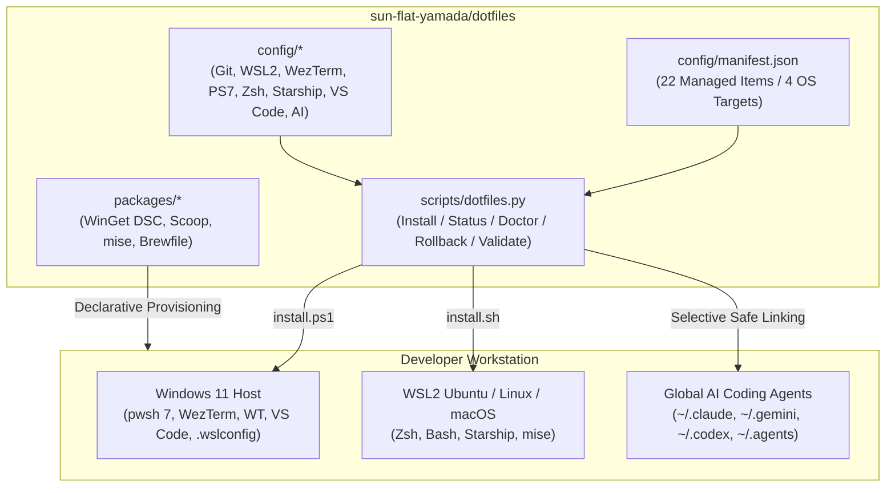

# dotfiles

**2026-era cross-platform dotfiles for Windows 11, WSL2 (Ubuntu), and Linux/macOS — uniting terminal, shell, editor, declarative package management, and Multi-AI Coding Agent configurations under a single transactional manifest.**

[](https://github.com/sun-flat-yamada/dotfiles/actions/workflows/ci.yml)
[](https://github.com/sun-flat-yamada/dotfiles/actions/workflows/secret-scan.yml)
[](config/manifest.json)
[-5332a0?style=flat)](config/vscode/settings.json)
[](LICENSE)
[](https://buymeacoffee.com/sun.flat.yamada)

[日本語版 (README.ja.md)](README.ja.md) | [🏛️ Architecture Overview](docs/architecture/overview.md) | [📖 Getting Started](docs/guides/getting-started.md) | [🔒 Security Policy](SECURITY.md) | [📋 ADR Records](docs/adr/)

---

## 🌟 Highlights (2026 Best Practices)

- **Declarative Single Source of Truth ([`config/manifest.json`](config/manifest.json))**: Maps 24 configuration artifacts across `windows`, `wsl`, `linux`, and `macos` into modular profiles (`full`, `core`, `git`, `wsl`, `terminal`, `shell`, `starship`, `editor`, `ai`, `packages`).
- **Transactional & Zero-Dependency Engine ([`scripts/dotfiles.py`](scripts/dotfiles.py))**: Pure Python 3.10+ stdlib engine wrapped by [`install.ps1`](install.ps1) and [`install.sh`](install.sh). Features `--dry-run`, drift detection (`LINKED`, `IDENTICAL`, `DRIFTED`, `MISSING`), automatic timestamped backup (`~/.dotfiles-backup/<timestamp>/restore-manifest.json`), Windows redirected `Documents` folder detection, symlink-to-copy fallback on Windows, and one-command `rollback`.
- **Multi-AI Coding Agent Global Sync ([`config/ai/`](config/ai/))**: First-class global dotfile management for **Claude Code** (`CLAUDE.md`, `settings.json`, `ccstatusline`), **Google Antigravity / Gemini CLI** (`GEMINI.md`, `settings.json`, `policies/permission-policy.toml`), **OpenAI Codex CLI** (`config.toml`), and universal agent instructions (`~/.agents/AGENTS.md`) — while strictly excluding ephemeral credentials and chat histories.
- **Unified `Dark 2026` Visual Identity**: Cohesive cyberpunk purple/gold/cyan palette (`#171c2a` deep canvas, `#a94dc1` active border, `#ffd866` cursor/accents, `#00B3BD` cyan, `#78e8c6` mint) across **VS Code**, **WezTerm** (WebGPU 120fps), **Windows Terminal**, and **Starship**.
- **Sub-50ms Shell Startup & Secret-Safe History**: PowerShell 7 and Zsh profiles lazy-load heavy CLI initializers (`zoxide`, `mise`) and actively block commands containing API keys or tokens (`ghp_*`, `gho_*`, `sk-ant-*`, `AIza*`) from being written to shell history files.
- **Declarative Package Provisioning ([`packages/`](packages/))**: Supports **WinGet Configuration DSC** (`configuration.winget`), **Scoop** (`scoopfile.json`), **`mise`** (`config.toml`), and **Homebrew** (`Brewfile`).

---

## 🏛️ System Architecture



---

## 🚀 Quick Start

### Windows 11 (PowerShell 7)

```powershell
# 1. Clone the repository (into ~/dotfiles or your preferred workspace directory)
git clone https://github.com/sun-flat-yamada/dotfiles.git "$HOME\dotfiles"
cd "$HOME\dotfiles"

# 2. Preview installation without modifying any files (Dry-Run)
.\install.ps1 -DryRun

# 3. Inspect current drift status against your home directory
.\install.ps1 -Status

# 4. Apply full profile (automatically backs up existing drifted files)
.\install.ps1 -Profile full

# 5. Run environment health diagnostics
.\install.ps1 -Doctor
```

### WSL2 (Ubuntu) / Linux / macOS

```bash
# 1. Clone the repository
git clone https://github.com/sun-flat-yamada/dotfiles.git ~/dotfiles
cd ~/dotfiles

# 2. Preview changes (Dry-Run) & inspect status
./install.sh --dry-run
./install.sh --status

# 3. Apply configurations
./install.sh --profile full

# 4. Run diagnostics
./install.sh --doctor
```

---

## 📦 Managed Configurations Inventory

| ID | Profile | Source Path | Target Platforms | Highlights |
| :--- | :--- | :--- | :--- | :--- |
| `git.config` | `git` | [`config/git/.gitconfig`](config/git/.gitconfig) | Win / WSL / Linux / macOS | `zdiff3`, `histogram`, `rerere`, `fsmonitor`, `updateRefs`, `~/.gitconfig.local` include |
| `git.ignore_global` | `git` | [`config/git/.gitignore_global`](config/git/.gitignore_global) | Win / WSL / Linux / macOS | OS noise, editor backups, `.env.local`, and AI agent credential/history exclusions |
| `git.attributes_global` | `git` | [`config/git/.gitattributes_global`](config/git/.gitattributes_global) | Win / WSL / Linux / macOS | Normalized LF/CRLF line endings across Windows & WSL2 |
| `wsl.host_config` | `wsl` | [`config/wsl/.wslconfig`](config/wsl/.wslconfig) | Windows | `networkingMode=mirrored`, `dnsTunneling=true`, `autoMemoryReclaim=dropcache`, `sparseVhd=true` |
| `wezterm.config` | `terminal` | [`config/wezterm/wezterm.lua`](config/wezterm/wezterm.lua) | Win / Linux / macOS | WebGPU 120fps, `Dark 2026` palette, Nerd Font fallback, Powerline tab title formatter |
| `wezterm.keybinds` | `terminal` | [`config/wezterm/keybinds.lua`](config/wezterm/keybinds.lua) | Win / Linux / macOS | Leader `Ctrl+q` multiplexer pane splitting, vim-style navigation, QuickSelect |
| `windows_terminal.fragment` | `terminal` | [`config/windows-terminal/settings.fragment.json`](config/windows-terminal/settings.fragment.json) | Windows | `Dark 2026` color scheme & PowerShell 7 profile fragment |
| `powershell.profile_default` | `shell` | [`config/powershell/Microsoft.PowerShell_profile.ps1`](config/powershell/Microsoft.PowerShell_profile.ps1) | Win / Linux / macOS | Sub-50ms lazy load (`zoxide`, `mise`), PSReadLine `ListView`, secret-safe history filter |
| `powershell.profile_vscode` | `shell` | [`config/powershell/Microsoft.PowerShell_profile.ps1`](config/powershell/Microsoft.PowerShell_profile.ps1) | Windows | Unified PowerShell profile for VS Code integrated terminal |
| `shell.zshrc` | `shell` | [`config/shell/.zshrc`](config/shell/.zshrc) | WSL / Linux / macOS | XDG compliance, 24h cached `compinit`, WSL clipboard/browser bridge, secret history filter |
| `shell.bashrc` | `shell` | [`config/shell/.bashrc`](config/shell/.bashrc) | WSL / Linux / macOS | Fast Bash setup sharing `.aliases`, Starship, `mise`, and `zoxide` |
| `shell.aliases` | `shell` | [`config/shell/.aliases`](config/shell/.aliases) | WSL / Linux / macOS | `eza`/`bat` modern replacements with POSIX fallbacks, Git & safety aliases |
| `starship.config` | `starship` | [`config/starship/starship.toml`](config/starship/starship.toml) | Win / WSL / Linux / macOS | Cross-shell prompt in `Dark 2026` colors with Git metrics and runtime indicators |
| `vscode.settings` | `editor` | [`config/vscode/settings.json`](config/vscode/settings.json) | Win / Linux / macOS | `Dark 2026` custom workbench theme, `HackGen Console NF`, Japanese word segmenter, Copilot hooks |
| `vscode.keybindings` | `editor` | [`config/vscode/keybindings.json`](config/vscode/keybindings.json) | Win / Linux / macOS | `Shift+Enter` chat submit protection (prevents accidental `Enter` sends in AI chat) |
| `ai.agents_global` | `ai` | [`config/ai/agents/AGENTS.md`](config/ai/agents/AGENTS.md) | Win / WSL / Linux / macOS | Universal Multi-AI Agent instructions (`~/.agents/AGENTS.md`) |
| `ai.claude_md` | `ai` | [`config/ai/claude/CLAUDE.md`](config/ai/claude/CLAUDE.md) | Win / WSL / Linux / macOS | Global Claude Code Japanese communication mandate & engineering rules |
| `ai.claude_settings` | `ai` | [`config/ai/claude/settings.json`](config/ai/claude/settings.json) | Win / WSL / Linux / macOS | Global Claude Code settings (`language: "japanese"`, `ccstatusline` integration) |
| `ai.ccstatusline` | `ai` | [`config/ai/ccstatusline/settings.json`](config/ai/ccstatusline/settings.json) | Win / WSL / Linux / macOS | Real-time Claude Code statusline (`model`, `context-length`, `reset-timer`, `session-usage`, `git`) |
| `ai.gemini_md` | `ai` | [`config/ai/gemini/GEMINI.md`](config/ai/gemini/GEMINI.md) | Win / WSL / Linux / macOS | Global Google Antigravity & Gemini CLI instructions |
| `ai.gemini_settings` | `ai` | [`config/ai/gemini/settings.json`](config/ai/gemini/settings.json) | Win / WSL / Linux / macOS | Global Gemini CLI settings (`disableYoloMode: true`, `sandbox: true`) |
| `ai.gemini_policy` | `ai` | [`.gemini/policies/permission-policy.toml`](.gemini/policies/permission-policy.toml) | Win / WSL / Linux / macOS | Global Gemini CLI Tier A/C/N permission guardrail policy (`~/.gemini/policies/`) |
| `ai.codex_config` | `ai` | [`config/ai/codex/config.toml`](config/ai/codex/config.toml) | Win / WSL / Linux / macOS | Global OpenAI Codex CLI sandbox & secret environment exclusion |
| `packages.mise` | `packages` | [`packages/mise/config.toml`](packages/mise/config.toml) | Win / WSL / Linux / macOS | Polyglot runtime versions (`node`, `python`, `go`, `uv`, `ripgrep`, `fd`, `jq`) |

---

## 🛠️ Declarative Package Provisioning

| Manager | Manifest Path | Command |
| :--- | :--- | :--- |
| **WinGet DSC** (Windows 11) | [`packages/winget/configuration.winget`](packages/winget/configuration.winget) | `winget configure -f packages/winget/configuration.winget` |
| **Scoop** (Windows User-Space) | [`packages/scoop/scoopfile.json`](packages/scoop/scoopfile.json) | `scoop import packages/scoop/scoopfile.json` |
| **mise** (Cross-Platform Runtimes) | [`packages/mise/config.toml`](packages/mise/config.toml) | `mise install` |
| **Homebrew** (WSL2 / Linux / macOS) | [`packages/homebrew/Brewfile`](packages/homebrew/Brewfile) | `brew bundle --file=packages/homebrew/Brewfile` |

---

## 🧪 Verification & Quality Gates

All changes are continuously verified on **Ubuntu** and **Windows** via GitHub Actions:

```bash
# Validate manifest integrity, JSON/TOML/YAML/Lua syntax, portability, and zero secrets
python scripts/dotfiles.py validate

# Run dotfiles unit & integration tests (install, idempotency, drift backup, rollback)
python tests/test-dotfiles.py -v

# Run AI Agent Permission Guard tests (Tier A / C / N enforcement)
python tests/test-permission-guard.py -v

# Run Markdown YAML front-matter and filename convention checks
python scripts/validate-frontmatter.py
python scripts/validate-filenames.py
```

---

## 🤝 Contribution & Support

Contributions, issues, and feature requests are welcome! Please read [CONTRIBUTING.md](CONTRIBUTING.md) before submitting pull requests.

[](https://buymeacoffee.com/sun.flat.yamada)

---

## 📄 License

MIT License - Copyright (c) 2026 @sun-flat-yamada (Youhei Yamada)  
See [LICENSE](LICENSE) for details.
