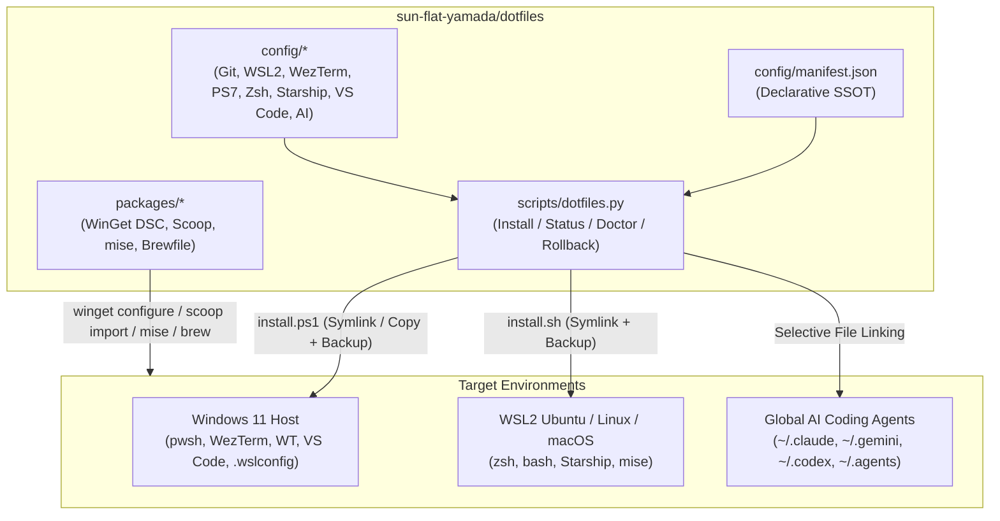

# 🏛️ Architecture Overview (`sun-flat-yamada/dotfiles`)

## 1. Design Philosophy

`sun-flat-yamada/dotfiles` is engineered around five core principles for the 2026 development ecosystem:

1. **Hybrid Windows 11 + WSL2 + Cross-Platform Harmony**: Treats Windows 11 (`pwsh`, WezTerm, VS Code, WinGet, Scoop) and WSL2 Ubuntu / Linux / macOS (`zsh`, `bash`, Homebrew, `mise`) as first-class citizens managed from a single declarative manifest.
2. **AI-Native Global Workstation**: Synchronizes global instructions, Japanese language policies, `ccstatusline` telemetry, and defense-in-depth permission guardrails across **Claude Code**, **Google Antigravity**, **Gemini CLI**, **OpenAI Codex CLI**, and **GitHub Copilot**.
3. **Transactional Safety & Idempotency**: Every installation supports `--dry-run`, detects configuration drift (`LINKED`, `IDENTICAL`, `DRIFTED`, `MISSING`), automatically backs up drifted files to `~/.dotfiles-backup/<timestamp>/`, and provides one-command `rollback`.
4. **Sub-50ms Shell Startup**: PowerShell 7 (`Microsoft.PowerShell_profile.ps1`) and Zsh (`.zshrc`) use lazy-loading stubs for heavy tools (`zoxide`, `mise`) and daily-cached completions.
5. **Defense-in-Depth Zero-Leak Security**: Shell history handlers actively filter out API keys and tokens before writing to disk; repository commits are guarded by `scripts/dotfiles.py validate`, `.githooks/pre-commit`, and Gitleaks CI.

---

## 2. System Topology



---

## 3. Repository Layout

```text
dotfiles/
├── install.ps1                  # Windows PowerShell 7 bootstrap & CLI wrapper
├── install.sh                   # WSL2 / Linux / macOS POSIX bootstrap & CLI wrapper
├── Makefile                     # Developer convenience targets (validate, test, status, doctor)
├── config/
│   ├── manifest.json            # Declarative SSOT mapping source files to per-OS targets
│   ├── ai/                      # Global Multi-AI Agent configurations
│   │   ├── agents/AGENTS.md     # Cross-agent core rules (~/.agents/AGENTS.md)
│   │   ├── claude/              # Claude Code global CLAUDE.md & settings.json
│   │   ├── ccstatusline/        # Real-time Claude Code statusline telemetry config
│   │   ├── gemini/              # Google Antigravity / Gemini CLI global GEMINI.md
│   │   └── codex/               # OpenAI Codex CLI global config.toml
│   ├── git/                     # .gitconfig (zdiff3, histogram, rerere), .gitignore_global
│   ├── powershell/              # Microsoft.PowerShell_profile.ps1 (<50ms lazy-loaded)
│   ├── shell/                   # .zshrc, .bashrc, .aliases (WSL2 interop & secret filter)
│   ├── starship/                # starship.toml (Dark 2026 cross-shell prompt)
│   ├── vscode/                  # settings.json (Dark 2026), keybindings.json, extensions.json
│   ├── wezterm/                 # wezterm.lua & keybinds.lua (WebGPU + multiplexer)
│   ├── windows-terminal/        # settings.fragment.json (Dark 2026 scheme)
│   └── wsl/                     # .wslconfig (mirrored networking, dropcache) & wsl.conf
├── packages/
│   ├── winget/                  # configuration.winget (WinGet DSC v0.2.0)
│   ├── scoop/                   # scoopfile.json (Buckets, CLI tools, Nerd Fonts)
│   ├── mise/                    # config.toml (Node, Python, Go, uv)
│   └── homebrew/                # Brewfile (WSL2 / Linux / macOS CLI suite)
├── scripts/
│   ├── dotfiles.py              # Core transactional dotfiles engine & validator
│   ├── install-hooks.py         # Git hooks installer (.githooks/)
│   ├── validate-filenames.py    # Strict file naming convention linter
│   └── validate-frontmatter.py  # Markdown YAML front-matter validator
└── tests/
    ├── test-dotfiles.py         # Unit & integration tests for dotfiles.py
    ├── test-permission-guard.py # AI agent permission guard test suite
    └── test-validate-frontmatter.py
```
